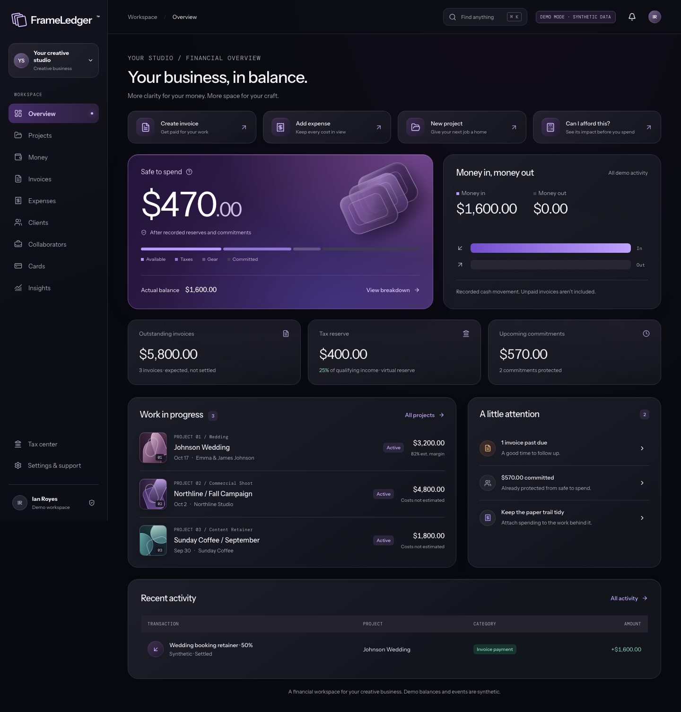
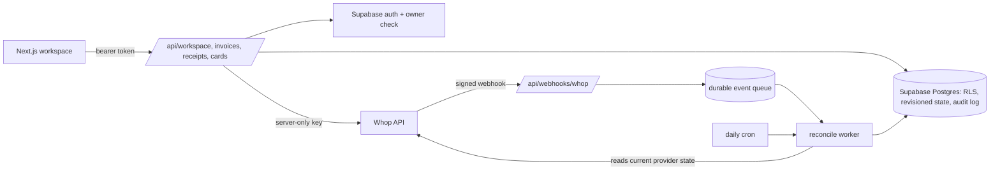

# FrameLedger

A money workspace for photographers, videographers and other independent creative businesses: send deposit and final invoices, set aside tax and gear money automatically, and see what each project actually earned.



## Why

Creative freelancers get paid in lumpy installments, owe second shooters and travel costs before the final invoice clears, and have no clear answer to "how much can I spend today?" FrameLedger ties every dollar to a project and answers that question from settled cash only. Open invoices never count as money you have.

## Features

- **Safe to Spend**: settled cash minus virtual tax, gear and protected reserves, minus contractor and travel commitments. Unpaid invoices are shown as scenarios, never as cash.
- **Project wallets** with deposit and final invoices, client and collaborator records, expense attribution and per-project profit (overhead such as software subscriptions is kept separate).
- **Allocations frozen at receipt time.** Changing your tax percentage affects future income only; refunds unwind reserves proportionally, down to the cent.
- **Commitments that don't double count.** Logging the actual fuel cost consumes the travel estimate instead of adding a second expense.
- **"Can I afford this?" simulator** and 30/60/90-day cash-flow scenarios.
- **Private receipts** in a Supabase storage bucket, plus deterministic "ask your money" questions over the workspace (no external model, no advice, no money actions).
- **Demo mode** with a clearly labeled synthetic wedding scenario stored only in the browser. No sign-in, no real money.
- **Production mode** with Supabase auth, owner-only row-level security, server-validated commands, an append-only audit log and Whop as the payment provider.
- **Native SwiftUI preview app** in `mobile/` with a shared integer-money Swift package and UI tests.

The acceptance example used throughout the tests: a $1,600 deposit with 25% tax, 10% gear, a $450 second shooter and $120 travel leaves **$470 Safe to Spend**.

## How it works



- `src/domain` is a pure TypeScript money engine in integer USD cents (BigInt intermediates, basis-point percentages, deterministic largest-remainder allocation). The demo, server commands, reconciliation and tests all use it.
- Whop is the source of truth for real payments and available funds; Supabase holds creator context. Reserves are bookkeeping entries, not separate bank accounts.
- Webhooks are signature-checked before parsing and stored with unique event IDs. The worker always re-reads the current provider resource, so late or duplicate events cannot roll state back. A daily cron sweep recovers anything missed.
- Invoice sends record a unique operation before calling the provider. An uncertain result is flagged for recovery instead of being re-sent.
- Card and payout routes return only non-sensitive fields, require explicit confirmation, and stay disabled behind `WHOP_PAYOUTS_ENABLED` / `WHOP_CARD_ISSUING_ENABLED` until provider approval.

More detail: [architecture](docs/architecture.md), [Whop capabilities and gaps](docs/whop-capabilities.md), [security review](docs/security-review.md).

## Tech stack

Next.js 16 (App Router), React 19, TypeScript, Zod, Supabase (Postgres, Auth, Storage, RLS), Whop SDK and Elements, Vitest with PGlite for database tests, Playwright with axe-core, SwiftUI for the iOS preview.

## Getting started

Demo mode needs no credentials:

```bash
npm ci
npm run dev -- --port 3210   # open http://127.0.0.1:3210
```

Production mode: copy `.env.example` to `.env.local` and fill in:

| Variable | Purpose |
| --- | --- |
| `FRAMELEDGER_MODE` | `production` enables the authenticated workspace; unset is demo |
| `APP_ORIGIN` | Browser-facing origin, checked on writes |
| `NEXT_PUBLIC_SUPABASE_URL`, `NEXT_PUBLIC_SUPABASE_ANON_KEY` | Supabase project (RLS still applies) |
| `SUPABASE_SERVICE_ROLE_KEY` | Server-only key for validated commands |
| `WHOP_API_KEY`, `WHOP_WEBHOOK_SECRET`, `WHOP_ENVIRONMENT` | Whop credentials; `sandbox` by default |
| `WHOP_PAYOUTS_ENABLED`, `WHOP_CARD_ISSUING_ENABLED`, `WHOP_FEE_CHANGES_ENABLED` | Safety switches, off unless approved |
| `WHOP_TRANSFER_FEE_DISCLOSURE`, `WHOP_CARD_TERMS_URL`, `WHOP_PLATFORM_ACCOUNT_ID` | Disclosure copy and platform account |
| `CRON_SECRET` | Protects the scheduled reconciliation route |

Apply `supabase/migrations/*.sql` in filename order, then run `npm run check:setup` (checks configuration without contacting providers). Full setup: [Supabase](docs/supabase-setup.md), [operational launch](docs/operational-launch.md).

Checks:

```bash
npm run lint && npm run typecheck
npm test            # Vitest, including PGlite RLS and stress tests
npm run test:e2e    # Playwright against an isolated demo build (npx playwright install chromium webkit)
swift test --package-path mobile/FrameLedgerCore
```

## Project structure

```
src/
  domain/        Integer-cent money engine and state schema
  server/        Auth, Whop adapter, webhook verification, reconciliation, cards, transfers
  app/api/       Workspace, invoices, receipts, cards, payouts, webhooks, cron
  app/pay/       Client-facing invoice payment page
  components/    Workspace UI, demo store, live-mode gates
  lib/           Intelligence queries, consent-gated analytics, pricing hypotheses
supabase/
  migrations/    Core schema, payouts, cards, readiness, service privileges
tests/           Vitest unit/integration/stress tests and Playwright e2e
scripts/         Setup checks, Supabase/Whop verifiers, visual QA, fee-policy tool
mobile/          SwiftUI preview app, FrameLedgerCore package, UI tests
docs/            Product spec, research, architecture, security and launch docs
```

## Status

Prototype, not publicly deployed. Demo mode is complete and tested locally; production mode has passed two-user acceptance against a private Supabase staging project. Whop integration is written against the official docs but has not run live: provider approval, public hosting and SMTP are still open. No real money has moved. An internal-only TestFlight build of the synthetic-data iOS preview was uploaded. "FrameLedger" is a working name, and the product is not a bank.

Built by [Ian Royes](https://github.com/ianroyes-sys)
